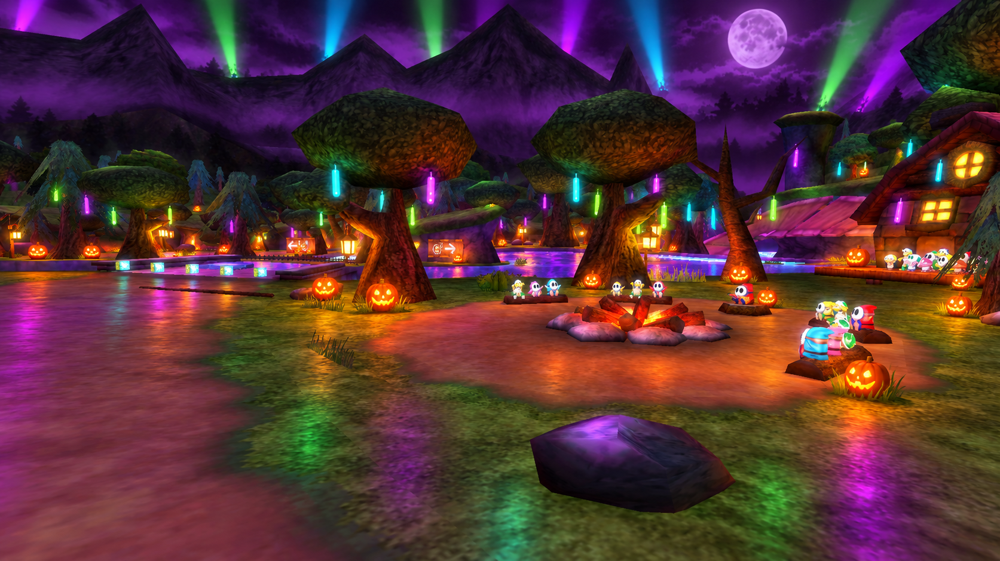

 
 

### A Mario Kart Wii mod, and the launcher that runs it.
**Pick your Dolphin. Pick your game. Press Play.**

 

---

## What it does

| | |
|---|---|
| **Play in one click** | Sets the mod up inside Dolphin's `Load/Riivolution` folder and starts the game. |
| **Always up to date** | Pulls from [Nitropack](https://github.com/mkwiichannel/Nitropack) and only downloads files that changed. Every file is hash-checked, and an interrupted download picks up where it stopped. |
| **Updates itself** | New launcher versions come from this repo's official releases, are checked against a checksum, and replace the old exe. |
| **Mii editor** | Pick every part visually, with a live preview right next to it. |
| **Performance mode** | One switch that starts Dolphin with settings tuned for speed. |
| **My Stuff** | Drop your own files, like music, into a folder and the launcher puts them into the mod for you. |
| **16 languages** | All strings live in [`translations.json`](translations.json). |
| **Small and quick** | One `.exe`. No installer. |

## What you need

- Windows 10 or 11
- [Dolphin](https://dolphin-emu.org/) with Riivolution support
- Your own Mario Kart Wii ISO or WBFS. This project doesn't provide one and never
  will.

## Get started

1. Download `MarioKartNitro.exe` from the [Releases](../../releases) page.
2. Run it and point it at `Dolphin.exe` and your game file.
3. Let it download the mod the first time.
4. Press **Play**.

Updates are checked every time the launcher opens.

## Where things come from

| What | Source | How it arrives |
|---|---|---|
| Mod files | [`mkwiichannel/Nitropack`](https://github.com/mkwiichannel/Nitropack) | Incremental, hash-checked sync |
| Launcher | [Latest release](../../releases/latest) of this repo | Prompt, then the exe is swapped and restarted |

## License

GPL v3, see [LICENSE.txt](LICENSE.txt). Third-party parts and their licenses are
listed in [THIRD_PARTY_NOTICES.md](THIRD_PARTY_NOTICES.md).

---

**Questions, bugs, or just want to race?** Come to the [Discord](https://discord.gg/AhkHNPG65G).

Made by Dom (mkwiichannel).

