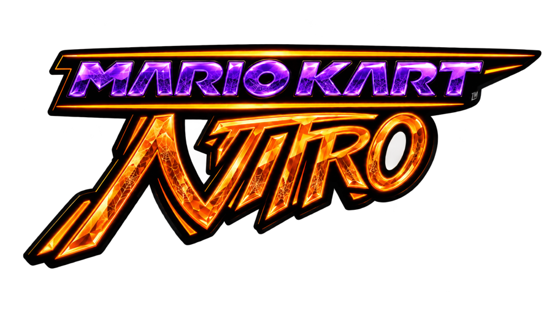

# Mario Kart Nitro

**A Mario Kart Wii mod and the small launcher that runs it.**
Pick your Dolphin, pick your game, press Play.

---

## Why a launcher?

Running a big Mario Kart Wii mod normally means editing Riivolution XML files,
copying folders into the right place, and fixing Dolphin settings by hand every
time something updates. Nitro does all of that for you. You press one button and
the game starts.

## What it does

- **Play in one click.** Sets up the mod inside Dolphin's `Load/Riivolution`
  folder and starts the game.
- **Keeps the mod up to date.** Pulls from the
  [Nitropack](https://github.com/mkwiichannel/Nitropack) repo and only downloads
  files that changed. Every file is checked against its hash, and a download that
  gets interrupted picks up where it stopped.
- **Updates itself.** New launcher versions come from this repo's official
  releases, are checked against a checksum, and replace the old exe.
- **Mii editor.** Pick every part visually, with a live preview next to it.
- **Performance mode.** One switch that starts Dolphin with settings tuned for
  speed (native resolution, no anti-aliasing, faster CPU and video options, 60 Hz
  for PAL). It only applies to that launch. Your own Dolphin settings are never
  touched.
- **My Stuff.** Drop your own files (like music) into a folder and the launcher
  puts them into the mod for you.
- **16 languages.** Strings live in `translations.json`.
- **Small and quick.** One `.exe`, no installer, made to run fine on modest PCs.

## What you need

- Windows 10 or 11
- [Dolphin](https://dolphin-emu.org/) with Riivolution support
- Your own Mario Kart Wii ISO or WBFS. This project doesn't provide one and never
  will.

## Get started

1. Download `MarioKartNitro.exe` from the [Releases](../../releases) page.
2. Run it and point it at `Dolphin.exe` and your game file.
3. Let it download the mod the first time.
4. Press Play.

Updates are checked every time the launcher opens.

## Where things come from

| What | Source | How it arrives |
|---|---|---|
| Mod files | [`mkwiichannel/Nitropack`](https://github.com/mkwiichannel/Nitropack) | Incremental, hash-checked sync |
| Launcher | [Latest release](../../releases/latest) of this repo | Prompt, then the exe is swapped and restarted |

## License

GPL v3, see [LICENSE.txt](LICENSE.txt). Third-party parts and their licenses are
listed in [THIRD_PARTY_NOTICES.md](THIRD_PARTY_NOTICES.md).

## Community

Questions, bugs, or just want to chat? Come to the
[Discord](https://discord.gg/AhkHNPG65G).

---

Made by Dom (mkwiichannel).
